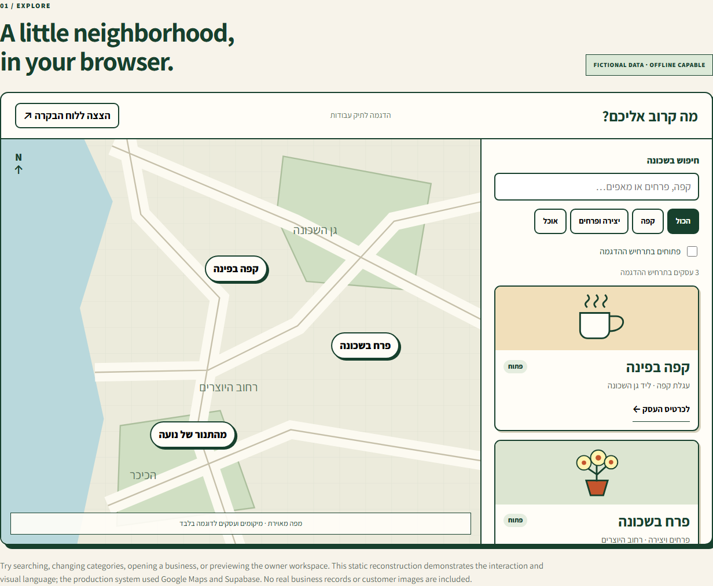
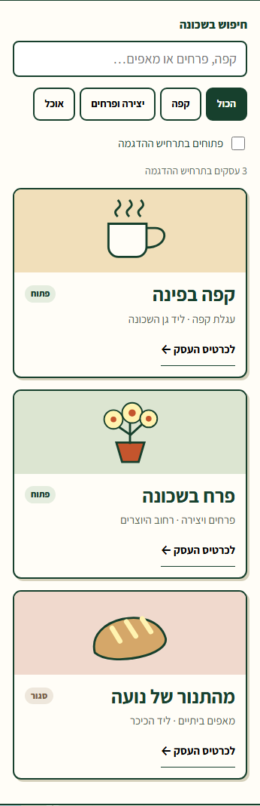
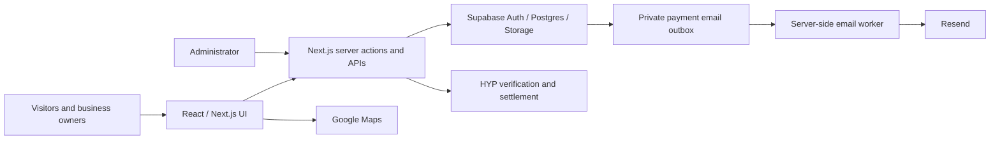

# פה קרוב · Po Karov

**Local business discovery, built for Hebrew and the way small businesses actually operate.**

An independent full-stack project by [Daniel Lankry](https://github.com/DanielLankry), covering product design, frontend and backend development, payments, deployment, and day-to-day administration.

[**Explore the interactive demo →**](https://pokarov.co.il/showcase/index.html) · [Engineering decisions](#engineering-decisions) · [Run locally](#run-locally)



> **Project status:** The commercial service is winding down, with existing promotional periods honored through their individual expiry dates; the last ends on 6 January 2027. The project is preserved here for portfolio review. The [customer service notice](https://pokarov.co.il/service-update) explains the transition.
>
> **About the demo:** Screenshots and the standalone demo use fictional businesses and original illustrations. The demo reconstructs selected interactions without accounts, payments, tracking, or a live database. The production application uses Google Maps and Supabase.

## The product

Small and mobile businesses need more than a pin on a map: customers need to know what is nearby, whether it is open, and how to reach it. Owners need a practical way to manage their listing, while the operator needs to handle approval, payments, and support.

| Audience | Main workflows |
| --- | --- |
| Visitors | Search nearby businesses; switch between map and list; filter results; view photos, hours, reviews, and contact details. |
| Business owners | Manage profiles, photos, and schedules; see publication progress; review listing periods and payment history. |
| Administrator | Approve listings, review payments, manage content, and answer customer messages through a private support inbox. |

<details>
<summary>Mobile preview</summary>



</details>

## Stack

| Layer | Technologies |
| --- | --- |
| Application | Next.js 16 App Router, React 19, TypeScript |
| Interface | Tailwind CSS 4, Radix UI, Hebrew RTL layouts |
| Data and identity | Supabase Auth, PostgreSQL, row-level security, private Storage |
| Maps | Google Maps JavaScript API |
| Payments and email | HYP, Resend |
| Delivery and testing | Vercel, Playwright, Node test runner, PGlite |

## Architecture



Public discovery, owner access, and administrator actions have separate boundaries. Approval, publication, payment, and delivery are modeled as distinct states.

## Engineering decisions

| Challenge | Approach and trade-off | Code |
| --- | --- | --- |
| A business can remain open past midnight or cross a daylight-saving change. | Centralize Israel-time schedule resolution and share it across discovery views. More calendar-aware logic, fewer conflicting “open now” results. | [Schedule resolver](lib/utils/schedule.ts) · [Tests](tests/schedule.test.mjs) |
| A payment redirect can be delayed, repeated, or absent. | Verify provider state on the server, retain pending attempts when verification is inconclusive, and snapshot listing entitlements for refunds. Missing callbacks still require reconciliation. | [Payment state](lib/payment-state.ts) · [Return handler](app/api/payments/return/route.ts) |
| Public listings and private ownership need different access. | Use scoped queries, column grants, RLS, and short-lived photo URLs instead of exposing entire records or a public photo bucket. | [Business queries](lib/db/businesses.ts) · [Photo URLs](lib/storage/photo-urls.ts) · [Migrations](supabase/migrations) |
| Saving a payment must not depend on an email provider being available. | Queue immutable email requests with payment-state changes; claim jobs server-side and retry with stable idempotency keys. Track acceptance separately from delivery. | [Email outbox](lib/payment-email-outbox.ts) · [Regression tests](tests/payment-email-triggers.test.mjs) |

## Run locally

### Standalone demo — no credentials

```bash
git clone https://github.com/DanielLankry/po-finder.git
cd po-finder
python -m http.server 8000 --bind 127.0.0.1 --directory public/showcase
```

Open [localhost:8000](http://localhost:8000). Try category filters, text search, the open-only toggle, business details, and the owner-workspace preview. All assets and fonts are bundled locally.

<details>
<summary>Full application setup</summary>

Use Node.js and npm with your own disposable Supabase project. Create `.env.local` from [`.env.local.example`](.env.local.example), configure only the integrations you intend to exercise, and review the [database migrations](supabase/migrations) before applying them to your own project.

```bash
npm ci
npm run dev
```

Open [localhost:3000](http://localhost:3000). Maps, authentication, payments, and email require their respective configuration; the source is not a preconfigured production environment. Use provider test environments and synthetic data. Never run destructive tests or database resets against the live service.

</details>

## Verification

```bash
node --experimental-test-module-mocks --test tests/*.test.mjs
npx tsc --noEmit
npm run lint
npm run build
```

The repository includes unit and PostgreSQL invariant tests, plus Playwright coverage for public pages, authentication, and owner/admin workflows. Tests exercise schedule boundaries, payment state transitions, access rules, and email behavior. Provider round trips and live operating conditions require separate checks.

Destructive Playwright suites are explicitly gated and intended only for disposable environments. See [the test configuration](playwright.config.ts) before running browser suites.

## Navigate the source

```text
app/                  Public pages, owner/admin workspaces, API routes
components/           Discovery, map, dashboard, and shared UI
lib/                  Domain rules, database access, provider adapters
supabase/migrations/  Schema, grants, policies, and database invariants
supabase/templates/   Branded authentication emails
tests/                Native, PostgreSQL, and Playwright coverage
public/showcase/      Portable fictional demo, independent of the backend
```

**Demo assets:** The bundled Assistant font is distributed under its [SIL Open Font License](public/showcase/ASSISTANT-LICENSE.txt). The illustrations and sample businesses in the demo were created for this project.
